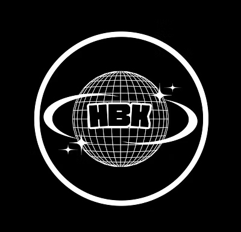

# HBK Futsal — Site Structure & Logo Animation Brief

**For:** Kimi K3
**Scope:** The HBK Futsal website only.
**Goal:** Add a space-themed entrance animation in which the HBK logo — a ringed
sphere — spins into view.

Read section 6 before writing any animation code. There is a blocking asset
problem there that determines the entire approach.

---

## 1. What this site is

HBK Futsal ("Humble Ballers Klub") is a men's and women's NFPL futsal club based
in San Jose, California. The site is a small marketing site: rosters, coaching
staff, training programs, match schedule, sponsorship, and contact.

It is **plain static HTML and CSS**. There is:

- No framework (no React, Vue, Svelte)
- No build step (no npm, no bundler, no preprocessor)
- No JavaScript dependencies — every script is vanilla and inline
- No package.json

You open a file, you edit it, it works. **Keep it that way.** Do not introduce a
build tool, a JS framework, or an animation library (no GSAP, no Three.js, no
Lottie runtime) unless a section below explicitly permits it. The owner edits
these files by hand.

---

## 2. File structure

Root: `hbk\` — this folder *is* the web root. Its contents get uploaded as-is.

```
hbk\
├── index.html          Home. Hero, Nationals, About, both squads, signings, Instagram, sponsor, contact
├── teams.html          Full men's + women's rosters
├── schedule.html       Season fixtures + Nationals match posters
├── coaches.html        7 staff profiles
├── programs.html       Skills training, youth pathway, NFPL squads
├── sponsors.html       Sponsorship pitch
├── book-online.html    Booking / contact
├── portal.html         Client portal (see section 9) — noindex
│
├── styles.css          ONE stylesheet. Every page loads it.
├── sitemap.xml         7 public URLs
├── robots.txt
│
└── assets\
    ├── logo.jpg              THE LOGO — see section 6
    ├── mens-squad.jpg        Hero slide 1 + teams page
    ├── women-squad.jpg       Hero slide 2 + teams page
    ├── nationals-2026.jpg    Nationals flyer
    ├── player-owner.jpg      About section
    ├── why-hbk.jpg           Programs card
    ├── skills-program.jpg    Programs card
    ├── conference-champions.jpg  Programs card
    ├── coaches\              7 headshots, Firstname-Lastname.jpg
    ├── players\              11 player photos
    ├── services\             7 images, currently unused
    └── news\                 8 social posters (signings, match schedules)
```

There is also a folder named `new assets\` beside `assets\`. **Ignore it.** It is
an unused duplicate of `assets\news\`. Nothing references it.

---

## 3. How the CSS is organised

`styles.css` is a single file, roughly 1,000 lines, ordered by page section with
banner comments:

```
NAVIGATION → HERO → SECTION SCAFFOLDING → NATIONALS → ABOUT → FEATURE CARDS →
TEAMS → COACHES → PROGRAMS → SCHEDULE → SPONSOR → CONTACT → FOOTER →
PAGE HERO → ROSTER BADGE → SIGNINGS → MATCH POSTERS → INSTAGRAM →
CLIENT PORTAL → MOBILE POLISH → utilities
```

Naming is BEM-ish: `.block`, `.block__element`, `.block--modifier`. State classes
are `.is-active`, `.is-open`. Follow this convention.

### Design tokens — all in `:root` at the top of the file

```css
--navy:       #1a2240;   --navy-deep:  #11172e;
--cream:      #f6f1e6;   --cream-soft: #fbf8f1;   --cream-deep: #ece4d4;
--ink:        #1f1f2e;   --ink-soft:   #4a4a5c;   --muted:      #8a8a9a;
--line:       #d8cfbb;
--accent:     #c2a878;   --accent-deep: #9d8554;   /* warm muted gold */
--white:      #ffffff;
--shadow:      0 8px 24px rgba(17, 23, 46, 0.08);
--shadow-lift: 0 14px 40px rgba(17, 23, 46, 0.14);
--radius: 10px;
--max: 1240px;
```

Use these variables. Do not hard-code hex values.

### Fonts

Loaded via one Google Fonts `@import` at the top of `styles.css`:

- **Bebas Neue** — all headings, jersey numbers, the wordmark
- **Inter** (300/400/500/600/700) — body copy
- **Playfair Display** italic — occasional accent lines

### Breakpoints in use

`960px` (nav collapses), `980px`, `900px`, `820px`, `720px`, `600px` (mobile
layouts). Reuse these rather than inventing new ones.

---

## 4. Page anatomy

Every page shares the same shell:

```html
<header class="nav">        sticky, translucent white, logo left, links right
<section class="hero">      index.html only — full-bleed rotating squad photos
<section class="page-hero"> sub-pages — navy band with title
<section class="section">   repeating content band
<footer class="footer">     navy-deep
```

Section background modifiers alternate down the page: `.section--cream`,
`.section--cream-deep`, `.section--navy`.

The nav markup is duplicated across all 8 pages. **If you change the nav or the
logo markup, change it in all 8 files.** There is no templating.

### The hero (index.html) — where the animation goes

```html
<section id="home" class="hero">
  <div class="hero__slides" aria-hidden="true">
    <div class="hero__slide is-active" style="background-image: url('assets/women-squad.jpg');"></div>
    <div class="hero__slide" style="background-image: url('assets/mens-squad.jpg');"></div>
  </div>
  <div class="hero__inner">
    <p class="hero__eyebrow">The Official Home of</p>
    <h1 class="hero__title">HBK Futsal</h1>
    <p class="hero__tag">One club. Two squads. One mission.</p>
    <a href="#team" class="hero__cta">Meet the Players</a>
  </div>
  <div class="hero__dots">…</div>
</section>
```

Two squad photos cross-fade every 2.5s, driven by an inline IIFE at the bottom of
`index.html`. A dark gradient overlay sits on `.hero__slide::after` for text
contrast. The hero is `min-height: 78vh`.

The nav logo appears on every page as:

```html

```

styled to `52px × 52px`, `border-radius: 50%`, `object-fit: cover`.

---

## 5. Brand direction

There is a live tension worth naming. The **site** palette is navy / cream / warm
gold — restrained and editorial. The **brand assets** (logo, all 8 social posters
in `assets/news/`) are black and electric purple with chrome type and starfields
— a cosmic, nightclub aesthetic.

The space-themed animation belongs to the *poster* world, not the current site
palette. So decide deliberately:

- **Option A (contained):** the animation is a dark space moment at the top of
  the page that resolves into the existing cream/navy site. Lowest risk.
- **Option B (full remodel):** shift the site palette toward the poster identity
  — deep purple/black surfaces, chrome and violet accents — so the animation
  doesn't feel bolted on. Bigger job, more coherent result.

**Ask the owner which before repainting the whole site.** Do not silently
change the `:root` palette.

---

## 6. The logo — READ THIS FIRST

`assets/logo.jpg`, 400×400 pixels, ~39 KB.

**What it depicts:** a wireframe sphere covered in latitude/longitude grid lines,
with "HBK" in bold block letters across its equator, a Saturn-style orbital ring
tilted diagonally through it, three four-pointed sparkle stars around it, and a
thin circular badge outline enclosing the whole thing. White artwork on solid
black.

The mark is *already* a planet in space. The spin concept is correct.

### The blocking problem

**It is a JPEG with a baked-in opaque black square background.** JPEG supports no
transparency. Consequences:

1. Placed over a starfield, it renders as a visible black box, not a floating planet.
2. It cannot be recoloured, and its parts cannot be animated independently.
3. At 400px it will look soft when scaled up for a hero entrance.
4. JPEG compression has left artifacts around the thin white lines.

**Therefore: step one is rebuilding the logo as SVG.** Not optional. Trace it into
layered vector groups:

```
<svg id="hbk-logo">
  <g id="logo-badge">    outer circle outline
  <g id="logo-sphere">   the wireframe globe — meridians and parallels as separate paths
  <g id="logo-ring">     the orbital ring
  <g id="logo-wordmark"> the "HBK" letters
  <g id="logo-stars">    the three sparkles
</svg>
```

Separate groups are what make the animation possible at all: the sphere must spin
while the wordmark stays upright and readable, and the ring orbits on its own
axis. A flat raster cannot do this.

Keep a transparent PNG fallback for `<meta property="og:image">` and the favicon,
since social scrapers handle SVG unreliably.

---

## 7. The animation brief

**Concept:** the HBK planet arrives out of deep space, rotating, and settles as
the page's opening statement.

**Where:** the `index.html` hero, playing on load, ahead of the existing squad-photo
cross-fade.

### Suggested beat sheet (~2.5s total, tune to taste)

| Time | Beat |
|---|---|
| 0.0–0.4s | Black. Starfield fades up. |
| 0.3–1.4s | Planet scales up from distance, spinning on its vertical axis. |
| 0.8–1.8s | Orbital ring sweeps into its tilted resting position. |
| 1.4–2.0s | Rotation eases to rest. Wordmark resolves upright and readable. |
| 1.6–2.2s | Sparkles twinkle in, staggered. |
| 2.0–2.5s | Badge ring draws. Space fades to the hero; squad photos take over. |

After the entrance, let the sphere keep a very slow idle rotation (60–90s per
revolution) so it feels alive without being distracting.

### The rotation — the part that is easy to get wrong

The globe must read as a **sphere turning on its axis**, not a flat picture
spinning.

- `transform: rotate()` — **wrong.** Spins the artwork like a wheel; the "HBK"
  text tumbles upside down.
- `transform: rotateY()` on a flat image — **wrong.** The image turns edge-on and
  vanishes at 90°.

Correct approaches, in order of preference:

1. **Animate the SVG meridians.** In the vector rebuild, the vertical grid lines
   are individual paths. Animate their horizontal scale/position cyclically so
   they sweep across the sphere and compress toward the silhouette edges. This is
   how a wireframe globe actually reads as rotating. Pure CSS or a tiny
   `requestAnimationFrame` loop. Best result, no dependencies.
2. **Masked texture scroll.** Put a wide seamless wireframe texture inside a
   circular `clip-path`, and translate it horizontally on loop. Cheap, convincing,
   very performant. Add a radial gradient overlay for spherical shading.
3. **CSS 3D rings.** Build the sphere from stacked `rotateY`-offset circles in
   `transform-style: preserve-3d`. Genuinely 3D, but heavy on mobile GPUs.

Keep `#logo-wordmark` **outside** the rotating group so "HBK" never turns.

### Starfield

Generate with CSS — layered `radial-gradient` dots at varying sizes and opacities,
plus a slow parallax drift on two layers. Do not add a canvas library or ship a
background video for this.

---

## 8. Hard constraints

**Accessibility.** Honour reduced motion. Anyone with the OS setting on should get
the final composed logo immediately, with no spin, no starfield drift:

```css
@media (prefers-reduced-motion: reduce) {
  /* show the resting state, skip all animation */
}
```

Keep `alt` text / `<title>` on the SVG. Never trap keyboard focus behind the
animation. The page must be usable before the animation finishes.

**Play it once per session.** A 2.5-second gate on every page view is hostile to
returning visitors. Set a `sessionStorage` flag after the first play; on
subsequent loads render the resting logo instantly.

**Performance.** Animate only `transform` and `opacity` — these run on the
compositor. Never animate `width`, `height`, `top`, `left`, `margin`, or
`box-shadow` in a loop. Target 60fps on a mid-range Android phone. Total added
weight should stay under ~50 KB.

**Do not damage the SEO work.** This site is optimised to rank: unique titles and
meta descriptions per page, canonical URLs, Open Graph tags, an image-annotated
sitemap, and real indexable text content. Specifically:

- The `<h1>` must stay in the DOM as real text, not be replaced by the animation
- Do not `display: none` the hero content while animating
- Do not delay the Largest Contentful Paint behind a JS animation
- Do not convert any text content into images

**Mobile.** Roughly half of traffic is phones. The animation must work at 375px
wide, must not cause horizontal overflow, and must not drain battery. Consider
shortening or simplifying it below 600px.

**Don't break these.** The hero photo cross-fade, the mobile nav toggle, the
sticky nav, and the roster/poster layouts all currently work. Leave them
functioning.

---

## 9. Where the portal sits in the wider flow

The intended path for a client or prospect:

```
lushessences.com/index.html          Agency landing page. Lists 2 clients:
                                     HBK Futsal, and a tree-care company.
        ↓  click HBK Futsal
portal.html                          The client portal for that account.
                                     Cards for every page of the HBK build.
        ↓  click "Open Live Site"
index.html                           The live HBK Futsal site.
```

`portal.html` is the middle step — a client picks HBK on the agency site, lands on
the portal, sees that account's work, then opens the live site.

Two notes:

- `portal.html` currently sits inside the HBK folder and carries HBK's styling.
  Architecturally it belongs to the agency site, since it is the agency's tool.
  If the Lush Essences site is built as a separate project, this file should move
  there. Flag it; don't move it unilaterally.
- It is marked `noindex` on purpose. It must stay out of `sitemap.xml` and out of
  Google. It is a client-facing tool, not public marketing.

**Out of scope for you:** the Lush Essences agency site and the tree company. This
brief covers HBK only.

---

## 10. Definition of done

- [ ] Logo rebuilt as layered SVG with transparency, groups named as in section 6
- [ ] Sphere reads as genuinely rotating; "HBK" wordmark stays upright and legible
- [ ] Entrance plays on `index.html`, resolves cleanly into the existing hero
- [ ] CSS starfield, no library, no video
- [ ] Slow idle rotation after the entrance settles
- [ ] `prefers-reduced-motion` fully respected
- [ ] Plays once per session via `sessionStorage`
- [ ] 60fps on mid-range mobile; only `transform`/`opacity` animated
- [ ] No horizontal overflow at 375px
- [ ] `<h1>` and all body copy still real, crawlable text
- [ ] Nav logo updated consistently across all 8 HTML files
- [ ] Hero cross-fade, mobile nav, and sticky nav all still work
- [ ] Still zero build step, zero dependencies

---

## 11. How to preview

Do not open the HTML files by double-clicking. The `file://` protocol silently
breaks embeds, `fetch`, and some font loading. From the `hbk\` folder:

```
python -m http.server 8321
```

Then open `http://localhost:8321`.
